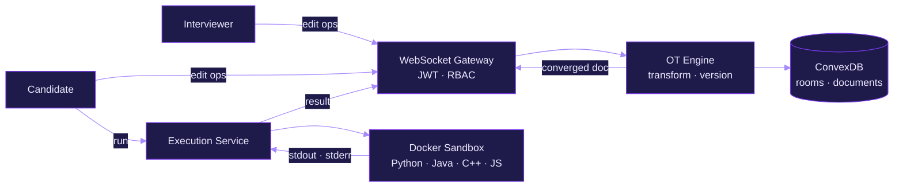

<div align="center">


<a href="https://git.io/typing-svg"></a>

<br/><br/>


<br/>


<br/><br/>

<a href="mailto:ayushsharma1895@gmail.com"></a>
<a href="https://github.com/Ayush-dev-ops"></a>

<br/><br/>


<a href="https://github.com/Ayush-dev-ops?tab=followers"></a>
<a href="https://github.com/Ayush-dev-ops?tab=repositories&sort=stargazers"></a>

</div>

---

<h2 align="center">About</h2>

I build software that has to keep working once real people start using it: editors that stay in sync while two people type at once, payment flows that can't lose a transaction, and task boards that update for a whole team at the same moment.

I'm a full-stack engineer with a B.Tech in Computer Science, specialising in AI & ML, from GL Bajaj (2022–2026). Most of my work spans the whole stack: React and Next.js on the front, Node.js, Express and Python services behind them, and data models in MongoDB or PostgreSQL that don't need rewriting three months later.

I co-founded **Voxel3**, a product and engineering studio, and take on freelance builds for clients who need something live rather than a demo. My main project, **CodeX**, is a collaborative interview platform with sub-100 ms sync built on Operational Transformation and a Docker sandbox that runs four languages.

The parts I care about most are the ones nobody notices when they're done well: clean API boundaries, auth that is actually enforced on the server, schemas that survive the next feature, and interfaces that stay smooth on slow hardware. On the AI side I work with LLM APIs, prompt design and retrieval pipelines, and I'm currently going deeper into agents and AI security.

| Focus | In practice |
|:--|:--|
| **Software Engineering** | Modular services, clear contracts between them, and code the next person can read |
| **Full Stack Development** | React and Next.js frontends on Node.js and Python backends with deliberate data models |
| **AI / ML** | LLM features built into real product flows, grounded with retrieval and tested on actual inputs |
| **Product Engineering** | Ship early to real users, watch what they do, and fix what matters first |

**Open to**

- Full-time Software Engineer, Full Stack and GenAI Engineer roles
- Remote-first and international teams
- Freelance and contract product builds
- Open-source work on developer tools and real-time systems

---

<h2 align="center">Tech Stack</h2>

<div align="center">

<h4>Languages</h4>


<h4>Frontend</h4>


<h4>Backend &amp; Databases</h4>


<h4>Cloud, DevOps &amp; Tooling</h4>


<br/><br/>


</div>

---

<h2 align="center">AI / ML Expertise</h2>

<div align="center">

| Domain | Proficiency | Details |
|:--|:--:|:--|
| **Generative AI & LLM Integration** |  | LLM APIs wired into product flows with streaming, structured outputs, retries and token budgets |
| **Prompt Engineering** |  | System prompts, few-shot patterns and output schemas that hold up across messy real inputs |
| **AI-Assisted Engineering** |  | Claude Code and agentic workflows as a daily productivity layer, without skipping the fundamentals |
| **Retrieval-Augmented Generation** |  | Chunking, embeddings and vector search to ground model answers in source documents |
| **Machine Learning Foundations** |  | Supervised learning, model evaluation and feature work in Python from the AI & ML specialisation |
| **AI Agents & AI Security** |  | Tool-using agents, prompt-injection defence and threat modelling for LLM applications |

</div>

---

<h2 align="center">Featured Projects</h2>

<details open>
<summary><b>CodeX</b> &nbsp;·&nbsp; Real-Time Collaborative Coding &amp; Interview Platform</summary>
<br/>

A browser-based technical interview environment where interviewer and candidate share one live editor, one execution sandbox and one source of truth. It runs on a custom Operational Transformation engine and an isolated, multi-language code runner.

| Dimension | Details |
|:--|:--|
| **Stack** | Next.js · React · Node.js · WebSocket · ConvexDB · Docker · Monaco Editor |
| **Scale** | 100+ concurrent users across isolated interview rooms |
| **Performance** | Sub-100 ms end-to-end sync of concurrent edits with guaranteed document convergence |
| **Security** | JWT auth, interviewer / candidate RBAC, ephemeral Docker sandboxes with hard CPU, memory and wall-clock limits |
| **Impact** | Collapses the editor, the runner and the interview workflow into a single real-time surface |
| **Repository** | Source private · [Live](https://code-x-interview-platform.vercel.app) |

Every keystroke is modelled as an operation, versioned against server state and broadcast over a persistent WebSocket channel. When two edits collide, the OT layer transforms one against the other before applying it, so every client converges on an identical document with no locks and no last-write-wins data loss.

Execution is decoupled from the collaboration path. A submission goes to a sandbox service that starts a short-lived, language-specific container for Python, Java, C++ or JavaScript, enforces resource ceilings, returns stdout and stderr, and tears the container down. Room state, roles and permissions are authoritative on the server, so a client can render the interview but never rewrite its rules.

</details>

<details>
<summary><b>Creator Platform</b> &nbsp;·&nbsp; Real-Time Fan Messaging &amp; Monetisation &nbsp;·&nbsp; Paid Client</summary>
<br/>

A production platform that lets a creator monetise her audience directly: paid fan access, two-way real-time messaging between fans and the creator, and an operations console, on an architecture built to absorb sudden traffic surges from Instagram.

| Dimension | Details |
|:--|:--|
| **Stack** | React · Node.js · Express · MongoDB · Razorpay · WhatsApp OTP |
| **Scale** | Engineered for burst traffic, when large waves of fans arrive the moment the creator posts |
| **Performance** | Stateless, horizontally scalable API layer keeps two-way chat responsive under concurrent load |
| **Security** | WhatsApp OTP identity, JWT-scoped access per fan, server-side Razorpay signature verification before any entitlement changes |
| **Impact** | Turned a social following into a direct, creator-owned revenue and engagement channel |
| **Repository** | Private (client work) · [Live](https://theankitasingh.com) |

At its core is a bidirectional messaging system between one creator and a large, paying fan base. Each conversation is bound to a verified fan and gated by an active subscription, so access control is enforced on every message path rather than at the page level.

Identity is phone-first: fans authenticate through a WhatsApp OTP flow, receive a signed JWT, and every API call is authorised against that token on the server. Payments run through Razorpay, and entitlements change only after the server verifies the payment signature, which keeps subscription state consistent even when a checkout is abandoned or retried. Users, subscriptions, payments and messages sit in separate MongoDB collections behind a modular Express service layer, and the admin console gives the creator one place to run fans, revenue and content.

</details>

<details>
<summary><b>ZenTask</b> &nbsp;·&nbsp; Team Workflow &amp; Task Orchestration Platform</summary>
<br/>

A multi-user project and task orchestration platform for teams, with Kanban workflows, role-scoped permissions and live board state shared across every member.

| Dimension | Details |
|:--|:--|
| **Stack** | React · Node.js · Express · MySQL · JWT |
| **Scale** | Multi-team workspaces with projects, boards and per-task lifecycle tracking |
| **Performance** | Board mutations propagate to every connected teammate in real time |
| **Security** | JWT authentication with role-based authorisation enforced at the API layer |
| **Impact** | A single source of truth for planning, assignment and delivery across a team |
| **Repository** | [ZenTask_full_stack](https://github.com/Ayush-dev-ops/ZenTask_full_stack) · [Live](https://zen-task-full-stack.vercel.app) |

Every drag-and-drop on the board is a state transition. The client sends it to the Express API, which validates it against the user's role, persists it to a relational MySQL schema and reflects the new board state for the rest of the team. Roles govern who can create projects, assign work and move tasks between stages, and those rules live on the server, so the interface can't be used to bypass them.

</details>

<details>
<summary><b>Stockpile</b> &nbsp;·&nbsp; Inventory &amp; Order Management System</summary>
<br/>

A full-stack inventory and order management system covering the complete lifecycle, from product catalogue and stock levels to customers and fulfilled orders, built on a typed Python API and a relational core.

| Dimension | Details |
|:--|:--|
| **Stack** | React · FastAPI · PostgreSQL · Docker |
| **Scale** | End-to-end lifecycle across products, inventory, customers and orders |
| **Performance** | Async FastAPI request handling over a normalised PostgreSQL schema |
| **Security** | Schema-validated requests through Pydantic models at every API boundary |
| **Impact** | Production-grade inventory workflow delivered under a fixed-stack brief |
| **Repository** | [Stockpile](https://github.com/Ayush-dev-ops/Stockpile) · [Live](https://stockpile-sandy.vercel.app) |

The backend treats inventory as relational data first. Products, stock, customers and orders are modelled in a normalised PostgreSQL schema with versioned migrations, so the data model can evolve without breaking what is already stored. FastAPI exposes async endpoints with Pydantic contracts that reject malformed input before it reaches business logic, and the whole stack is containerised with Docker so the same environment runs locally and in deployment.

</details>

<details>
<summary><b>Voxel3</b> &nbsp;·&nbsp; Tech Solutions Platform &nbsp;·&nbsp; Co-founder &amp; Team Lead</summary>
<br/>

The digital platform for Voxel3, the product and engineering studio I co-founded. It pairs real-time 3D scenes with a modular service backend that powers the studio's client pipeline.

| Dimension | Details |
|:--|:--|
| **Stack** | React · Node.js · Express · MongoDB · Tailwind CSS · Spline |
| **Scale** | Team-driven delivery across client and product engagements |
| **Performance** | Viewport-triggered loading of Spline scenes and compressed assets keep 3D smooth on mid-range devices |
| **Security** | Layered Express architecture separating routing, validation and persistence |
| **Impact** | Front door for Voxel3's client acquisition and project showcase |
| **Repository** | [Live](https://voxel3.netlify.app) |

Heavy 3D is the fastest way to ruin a landing page, so scenes stream in only when they enter the viewport and every asset is compressed before deploy. The backend follows a layered service architecture over MongoDB, with routing, business logic and persistence kept strictly apart, which lets the team ship features in parallel without stepping on each other.

</details>

---

<h2 align="center">Achievements</h2>

<div align="center">

| Recognition | Details |
|:--|:--|
| **Co-founder & Team Lead, Voxel3** | Leads the Voxel3 team, shipping client and product builds end to end |
| **Creator Platform (Paid Client)** | Shipped a production creator platform with real-time two-way fan messaging, OTP identity and integrated payments |
| **CodeX Real-Time Engine** | Sub-100 ms collaborative sync with 100+ concurrent users on WebSockets and OT |
| **Production Deployments** | CodeX, ZenTask, Stockpile and the Creator Platform are all live and in use |
| **Freelance Full Stack Developer** | End-to-end builds for clients on Fiverr and through direct engagements |

</div>

---

<h2 align="center">Architecture Spotlight</h2>

<p align="center"><i>How a single keystroke and a single code run move through CodeX</i></p>



---

<h2 align="center">Contribution Activity</h2>

<div align="center">

<a href="https://github.com/Ayush-dev-ops"></a>

</div>

---

<h2 align="center">Contribution Snake</h2>

<div align="center">

<picture>
  <source media="(prefers-color-scheme: dark)" srcset="https://raw.githubusercontent.com/Ayush-dev-ops/Ayush-dev-ops/output/github-snake-dark.svg" />
  <source media="(prefers-color-scheme: light)" srcset="https://raw.githubusercontent.com/Ayush-dev-ops/Ayush-dev-ops/output/github-snake.svg" />
  
</picture>

</div>

---

<h2 align="center">Current Focus</h2>

```yaml
learning:
  - LLM agents and tool-use orchestration
  - AI security, prompt-injection defence and threat modelling
  - System design for multi-tenant SaaS
  - DSA in Python, pattern by pattern

building:
  - CodeX, with continued work on sync and execution
  - Client products with the Voxel3 team
  - Freelance full-stack builds

exploring:
  - RAG evaluation and retrieval quality
  - Observability for real-time systems

open_to:
  - Full-time Software Engineer, Full Stack and GenAI Engineer roles
  - Remote-first and international teams
  - Freelance and contract product builds
```

---

<h2 align="center">Connect</h2>

<div align="center">

<a href="mailto:ayushsharma1895@gmail.com"></a>
<a href="https://github.com/Ayush-dev-ops"></a>

</div>

---

<div align="center">

<i>"Make it work, make it right, make it fast." — Kent Beck</i>

<br/><br/>


</div>
